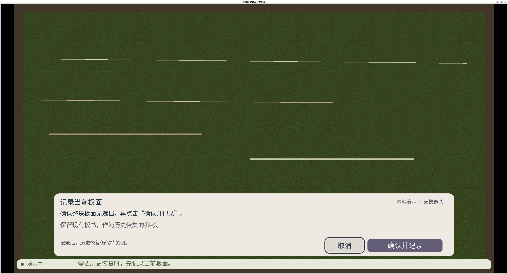
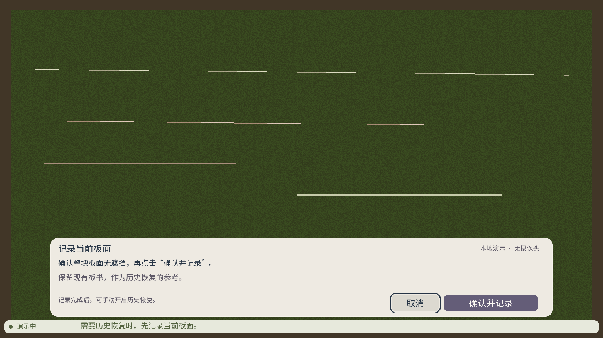
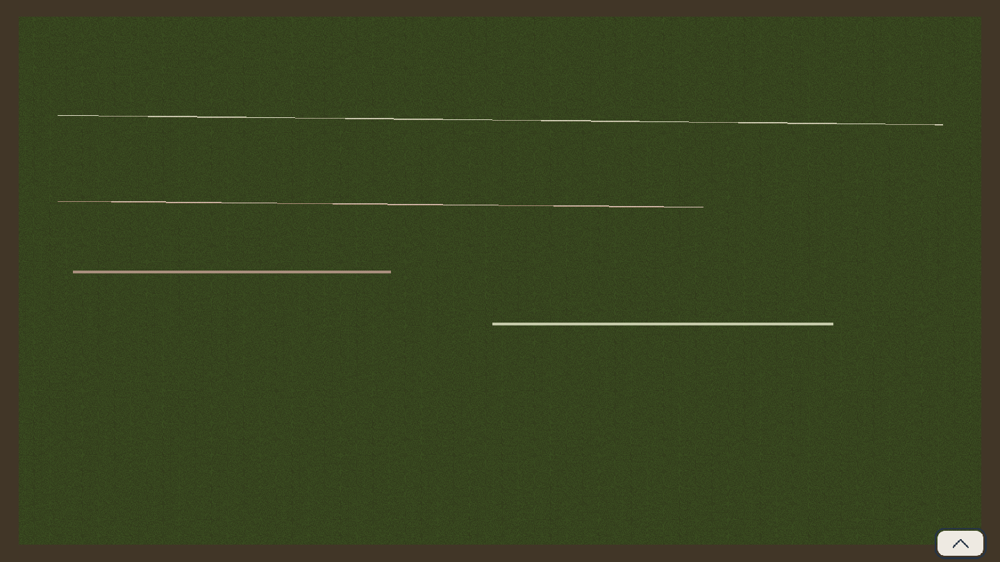
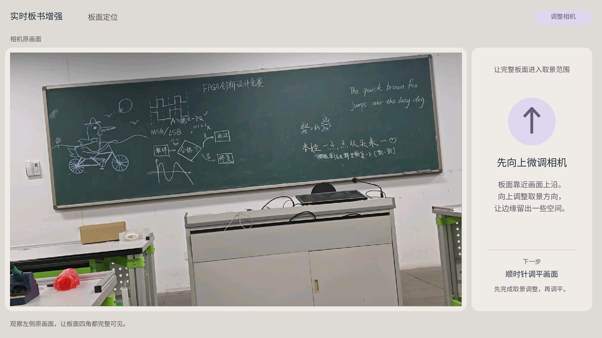
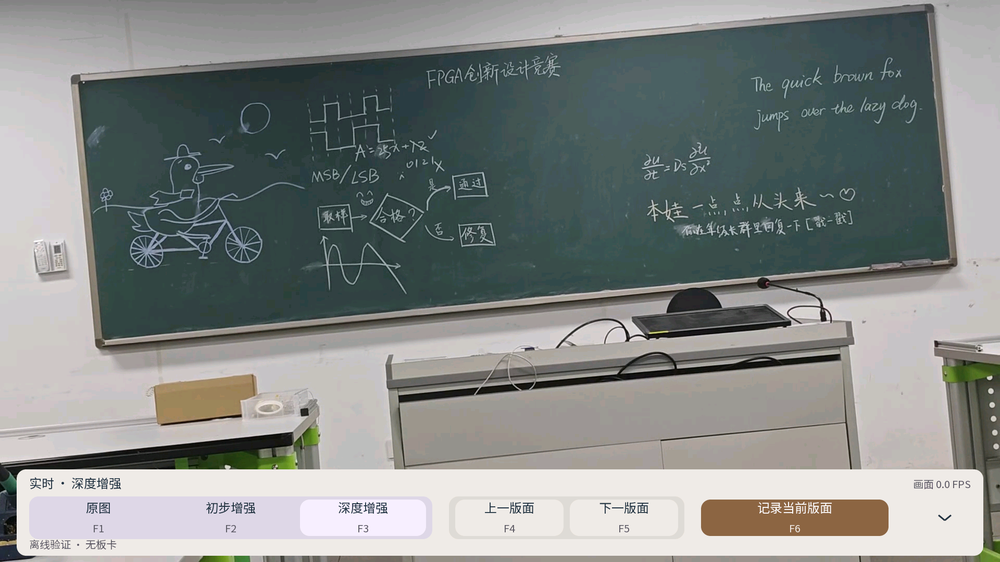

# UI主案例：从显示适配到需求驱动的交互与接入修正

2026-10-27范围补充：本文图片和验证均保留原历史版本，不换标题冒充当前V24界面。当前V24操作口径及新证据见[版本边界](version_and_contribution.md)和[V24增量](../../batches/v24_20261027/readme.md)。

> 审阅稿，整理于2026-10-22，补充核对于2026-10-23。正文是基于证据的案例叙述；引用短句来自已取得的可见消息。没有重新运行UI、训练或板端测试。原文仍按[U01](user_01_ui_linux/conversation.md)、[U02](user_02_ui_guidance/conversation.md)、[U03](user_03_ui_pipeline/conversation.md)三个来源保存，没有拼成一段虚构连续聊天。

本案例的目标是让操作界面适配1080p板书画面，减少遮挡，使提示和操作符合用户理解，并在接入PS时保留原有处理流水。用户负责提出需求、指出视觉与行为问题、修正方案取舍；历史AI完成了适配、实现与验证工作。已有LVGL/SDL2组件和团队PL/PS工程是输入基础，不能归为本轮整理或用户独立实现。

## 1. Linux适配后，先解决“看得见”与“用得明白”

最初要求是接入Linux显示后端，在WSL2检查中文与交互。AI沿用Noto Sans SC并接入SDL2；首次显示自检因默认64KiB内存池耗尽而停在断言，随后改为512KiB，并保留可定位的失败输出。早期窗口操作测试也发生截图触发、鼠标/焦点时序问题，没有因为编译成功就结束验证。

初版已有37项真实X11窗口检查，但用户仍对文案和颜色提出具体反馈：

> 图中的“记录后，历史恢复仍保持关闭是什么意思”

> 历史恢复开启的这个颜色不太好看，可以换成暖棕色

两张消息附件本轮已按平台返回的localImage精确路径找回。第一张确实显示旧文案，第二张显示原恢复按钮颜色；它们可证明反馈针对的界面，而不是后来补画的示意图。AI将提示改为“记录完成后，可手动开启历史恢复”，将开启状态改为暖棕色，对应x11_11的确认页与恢复页。**“记录”与“开启恢复”在该阶段仍是独立操作**；后续接入版本又改变了记录语义，不能混写。[附件对应表](user_01_ui_linux/attachment_index.md)

原反馈截图：

修改后的确认页：

这些截图分辨率不同，只用于核对文案与状态，不据网页缩放后的大小比较清晰度。

## 2. 界面不应长期遮挡板书：从箭头收起到空闲隐藏

用户指出UI占据画面比例过大，要求右下角上箭头展开、下箭头收起；随后追加无操作自动隐藏。AI将默认状态改为仅保留箭头，并设置10秒空闲收起、输入重新计时、确认/参数等弹窗保护。

这个阶段的验证也经历了修正。新取得的14条历史X11执行记录中，x11_01、05–10返回失败：包括未能取得预期截图、鼠标同步超时和指针未到目标；x11_11才形成47项通过回执。x11_12增加自动隐藏后为64项。它们属于不同测试步骤的开发过程，不能把“7条失败”当作用户使用失败率，也不能把后期成功覆盖早期记录。[执行记录索引](user_01_ui_linux/tool_evidence.md)

自动隐藏功能需要时间序列和操作回执支持，静态截图本身不能证明10秒计时正确。最终x11_14的既有回执记录约10.21秒隐藏，并覆盖键盘/鼠标重置和弹窗保护；Windows在这一过程中也曾因64KiB池耗尽触发断言，修正后的结果与失败日志都保留。[详细证据链](user_01_ui_linux/evidence_chain.md)

## 3. 清晰度优化遵循用户修订，保留被退回的Medium方案

用户先问能否在不增加很多资源的情况下改善清晰度。AI发现1920×1080源画布被缩到1440×810，并先把Regular改为Medium，字形位图仅增加3022字节。但用户随后明确：

> 请还原为regular。现在允许放宽资源使用限制，因为视频是1080P清晰度，所以我希望UI的清晰度也能与其适配

最终方案恢复Regular 400，改为8位灰度字形，默认1920×1080原生输出，窗口缩放使用平滑采样。字形位图为497,075字节，比前一Medium版增加245,491字节。x11_13的Medium预览、x11_14的最终图和资源JSON均保留，因此可以说明：**低资源方案曾被实际实施，但用户改变约束后选择了另一方案**，不能把Medium写成最终采纳结论。

| 阶段 | 实际结果 | 证据 |
| --- | --- | --- |
| 自动隐藏、Regular旧预览 | 1440×810窗口，64项检查 | [x11_12回执](../../evidence/ui_history/linux/x11_12/interaction_receipt.json) |
| Medium尝试 | 位图增加3022字节，64项检查 | [中间图](../../evidence/ui_history/linux/x11_13/main.png)、[资源](../../evidence/ui_linux/font_medium_resources.json) |
| Regular A8最终版 | 原生1920×1080，65项窗口检查；Linux4项、Windows3项CTest | [最终图](../../evidence/ui_linux/x11_14/main.png)、[最终回执](../../evidence/ui_linux/validation_receipt.json) |

测试数增加反映版本与覆盖变化，不是同条件性能比较。较早回执没有二进制SHA，不能冒用最终二进制身份；其来源由消息链接、执行记录、目录和既有导出manifest共同定位。

## 4. “已居中”仍被用户纠正：改进检查口径

相机引导页提供了另一个明确的人工纠错过程。AI最初统一字体并将说明文字块居中、块内左对齐；用户先要求三句话逐行居中，再要求标题居中。v3的验证记录给出中心偏差0，但用户仍指出：

> 目前仍然不是准确的居中对齐，请修改。

同时用户要求缩小右上角标签、减少右侧文案并统一所有动作。后续AI明确排版框留白与可见字形不同，将v4改成可见字形边界居中，统一动作28px/说明24px，标签随文字收缩。v4已有28页、100行可见文本检查，最大可见中心偏差0.5px。最后按用户要求把圆内箭头缩为80%，形成v5。

本轮找回v1–v4的原预览、各版manifest及验证JSON；连同v5，五版各31资源和28预览共295个文件哈希均匹配。这里的“0→0.5”**不是居中效果退步**，两个版本测量的边界定义不同。用户反馈促使测试从排版框指标转向可见字形指标。完整五版图和证据见[版本演变](user_02_ui_guidance/version_history.md)。

这些是指定视频帧与指定引导状态的离线合成，不能证明相机方向识别准确。

## 5. 接入PS时，用户纠正了调度和保存语义

UI接入PS的早期候选把板面识别降到2Hz、显示单独调度；约8秒回放有16次识别与208次显示提交。接入底栏后，AI为便于验证状态边界改为单帧处理，即使98项软件回归通过，也没有维持原有多阶段重叠流水。用户追问：

> 为什么改成了单帧调度？能否保留原来的多阶段流水，避免接入UI后影响视频帧率？

本轮找回中间候选的README、93/98项验证文件和窗口图。README明确承认尚未恢复流水，与用户质疑一致。此后用户又明确记录应保存当前模式的最终画面，并要求F1–F3与F4–F5分组。最终候选恢复三阶段重叠，F1原图、F2校正、F3恢复量化，F4/F5浏览历史，F6保存当前模式且不含UI；已有96项软件回归和三模式保存记录。[中间与最终证据对照](user_03_ui_pipeline/evidence_index.md)

截图标有“离线验证·无板卡”；各阶段使用硬件替身，所以深度增强模式下背景仍是原视频。它支持布局与软件状态验证，不能证明真实增强效果或板端吞吐。新候选的脚本回放与U01真实X11输入检查也分别保留，不交叉借用。

## 6. 可以成立的案例结论

这组材料已经能将需求、用户反例、AI修正、中间图和历史验证对应起来。最有代表性的经验是：界面可用性需要用户反馈补充自动检查；视觉检查要测量最终可见内容；接UI时必须同时守住处理流水与操作语义。

已验证范围仍限于记录所述的Windows/WSL、离线合成和软件替身。当前没有对应版本的KV260显示/键鼠/吞吐验收；历史模型型号和完整源码快照也未齐。两项UI附件已找回，不再列为缺失；原文没有扩充为虚构完整导出。由此提炼的[UI验证Skill](../../skill/ui-evidence-validation/readme.md)仍是草稿，未宣称跨任务迁移效果通过。

本次新增资料与哈希见[UI历史证据清单](../../ui_history_inventory.json)，验证范围见[本轮补充核对](../../ui_followup_verification.md)。
