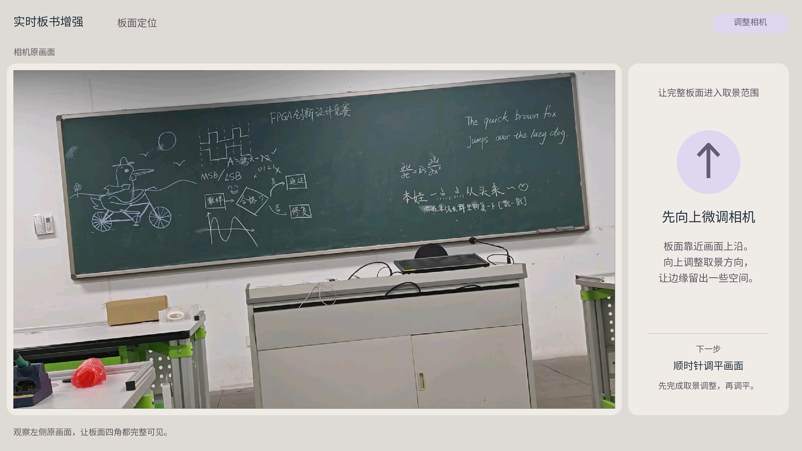

# U02：五版相机引导图及验证口径演变

本轮沿U05/U08/U11/U16/U19的真实消息链接找回对应PNG，并读取同目录manifest和已有validation。以下是历史版本对照，不是重新设计的图。五版均为1920×1080；只归档代表页及必要记录，其余资源做本地哈希核对。

| 版本 | 需求/反馈与处理 | 历史验证与本轮依据 |
| --- | --- | --- |
| v1，U01–U05 | Regular；标题/箭头居中，说明块整体居中、块内左对齐 | [validation](../../../evidence/ui_history/guidance/v1/validation.json)记录149行标称居中检查及0偏差；这不等于所有正文逐行居中 |
| v2，U06–U08 | 用户要求标题左对齐、下方三句话逐行居中 | [validation](../../../evidence/ui_history/guidance/v2/validation.json)：28标题左对齐、81正文居中 |
| v3，U09–U11 | 用户再要求标题居中 | [validation](../../../evidence/ui_history/guidance/v3/validation.json)：28标题/81正文，标称中心偏差0；U12仍提出视觉反例 |
| v4，U12–U16 | 按可见字形居中；动作28px、说明24px；短文案、标签自适应；统一所有方向 | [validation](../../../evidence/ui_history/guidance/v4/validation.json)：28页100行，可见中心偏差最大0.5px |
| v5，U17–U19 | 圆内箭头缩至80%，线宽同步调整 | [最终资源manifest](../../../evidence/ui_guidance/assets_20261018_v5/manifest.json)：icon_scale=0.8；没有取得单独v5 validation.json，不能补造一份历史PASS |

## 为什么早期0偏差仍被纠正

v1–v3的manifest声明使用排版边界，v4/v5明确改为visible glyph bounds。平台原文U15记载旧三行字形中心约左偏7px；当前只把7px保留为当时分析，不声称本轮重新测量旧图。

本轮对manifest中action/body/next的选定居中行复算，v3排版边界偏差0，v4/v5可见边界最大0.25px。这个子集分别是109/84/84行，和v4历史validation的100行测量范围不同，**不能用0.25替换历史0.5，也不能把两种边界直接比较优劣**。这组材料说明检验目标发生了修正。

五版各31个资源与28个预览（共295文件）都与各自manifest哈希相符，见[核对记录](../../../ui_history_inventory.json)。这验证文件身份，没有重新执行生成脚本或测量所有图像像素。v1记录有当时生成器源码SHA，但当前脚本已更新；中间源码快照/逐次diff仍未齐。

## v1：正文块内左对齐，信息量较大

## v2：标题左对齐，正文逐行居中

## v3：标题也居中，用户仍指出不准确

## v4：可见字形居中、文案精简和标签收缩

## v5：保留布局，缩短圆内箭头

左侧是真实视频帧，但方向状态由预览配置指定；这些图片只证明排版演变。所选U02消息的五条图片链接均已取得，不再将中间预览笼统列为缺失。
