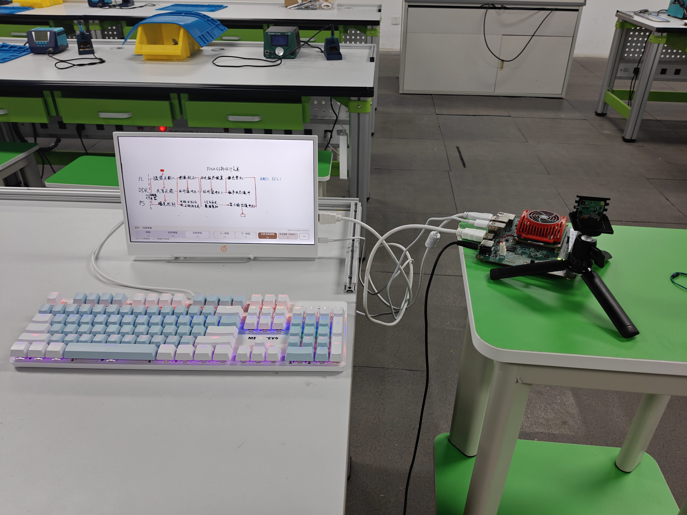
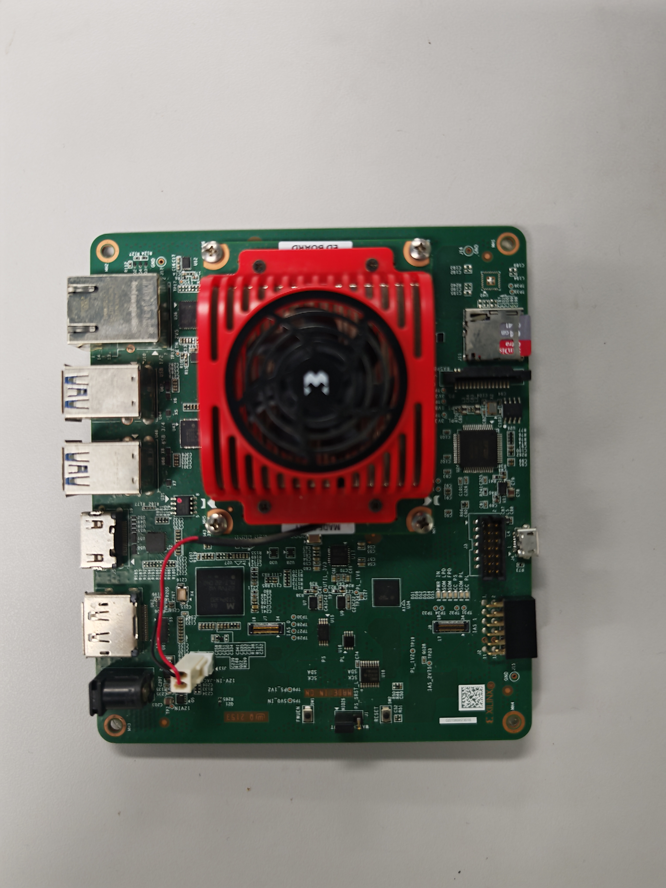
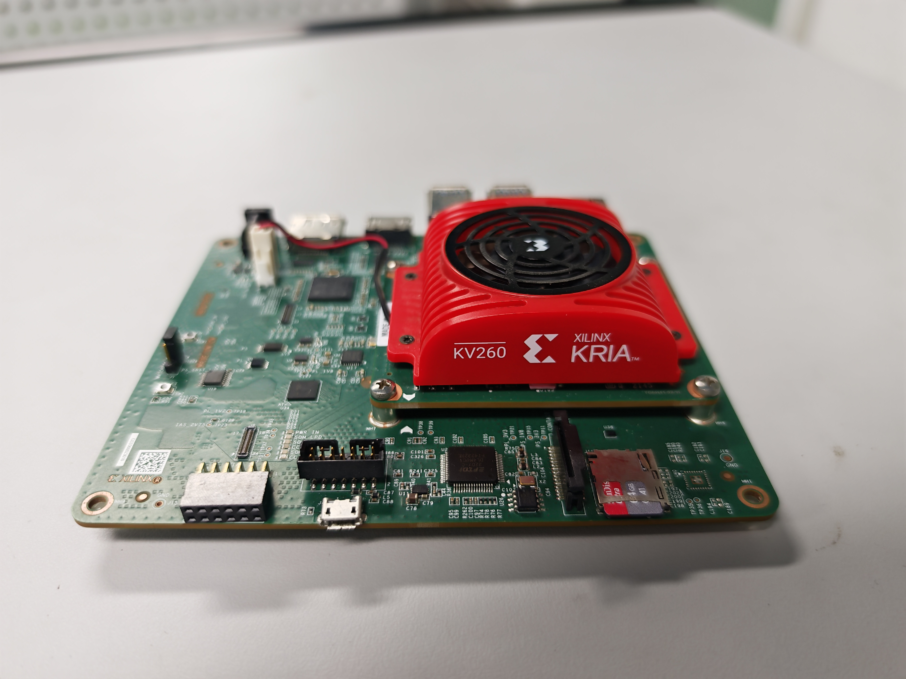

# Hardware photographs

收到日期：2026-11-03。三张照片使用用户提供的桌面原文件，统一为英文文件名，保留原始像素、EXIF 方向和文件字节。来源及 SHA-256 见 [source_manifest.json](source_manifest.json)。

| 文件 | 建议图题 | 报告用途 |
|---|---|---|
| [system_overview.jpg](system_overview.jpg) | 实时板书增强系统实物全貌 | 整机组成、运行界面与连接展示 |
| [kv260_top_view.jpg](kv260_top_view.jpg) | KV260 开发板俯视实物图 | 硬件平台及接口布局 |
| [kv260_oblique_view.jpg](kv260_oblique_view.jpg) | KV260 开发板斜视实物图 | 板卡结构、核心模块与散热组件 |

整机图中可见树莓派 V2 摄像头、KV260 开发板、香橙派便携显示屏和键盘；设备型号沿用项目物料信息。显示屏呈现板书画面及底部操作栏。

现有材料包含一个整机全貌视角和两个板卡特写视角。

## 整机全貌

## 开发板俯视

## 开发板斜视

